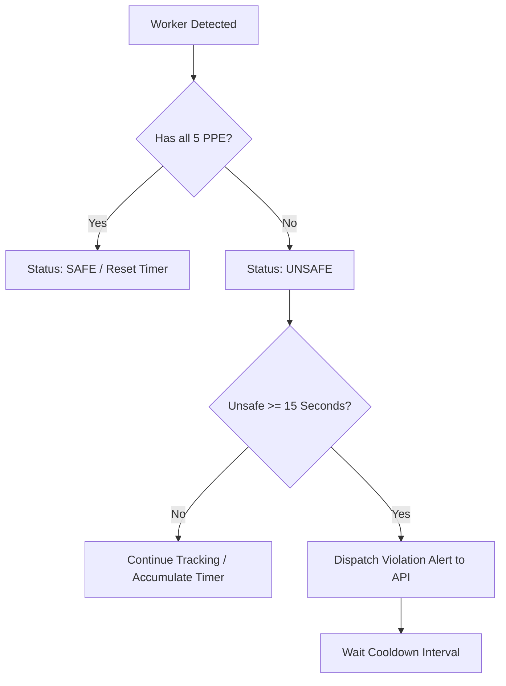

# VisionShield 🛡️
### AI-Powered Personal Protective Equipment (PPE) Compliance & Worker Safety Monitoring

[](https://www.python.org/)
[](https://pytorch.org/)
[](https://docs.ultralytics.com/)
[](https://fastapi.tiangolo.com/)
[](https://opencv.org/)
[](https://developer.nvidia.com/cuda-zone)

---

## 📌 Overview

**VisionShield** is an industrial-grade Computer Vision system engineered for real-time safety monitoring and automated Personal Protective Equipment (PPE) compliance detection on construction sites, manufacturing plants, and hazardous industrial environments.

By integrating state-of-the-art object detection models (including **Ultralytics YOLO11**, **Faster R-CNN ResNet-50-FPN**, and **SSD300-VGG16**), VisionShield detects individual workers, identifies safety equipment, associates gear to specific personnel via spatial geometry, tracks persistent worker identities across frames, and dispatches automated violation alerts through a high-performance **FastAPI** backend.

---

## ✨ Key Features

- **Multi-Model Computer Vision Architecture**:
  - **YOLO11n (Ultralytics)**: Ultra-fast real-time edge inference with custom 6-class and 10-class fine-tuned checkpoints.
  - **Faster R-CNN (ResNet-50-FPN)**: High-accuracy two-stage detection benchmark.
  - **SSD300 (VGG16)**: Single-shot multibox detector baseline for comparative evaluation.
- **Per-Worker Spatial PPE Association**:
  - Associates detected PPE items (`helmet`, `vest`, `gloves`, `boots`, `goggles`) to individual workers using expanded bounding box geometries and **Intersection-over-Area (IoA)** containment algorithms.
- **Persistent Worker Tracking**:
  - Employs **ByteTrack** multi-object tracking to maintain worker identities across consecutive frames in video and live webcam streams.
- **Debounced Smart Violation Engine**:
  - Eliminates alert fatigue: triggers an API alert only after a worker remains non-compliant for a sustained duration (e.g., continuously unsafe for 15 seconds), followed by throttled follow-ups.
- **Full-Featured FastAPI Backend**:
  - RESTful telemetry endpoints for real-time site analytics, safe vs. unsafe headcounts, detailed violation logs, and historical tracking.
- **Interactive OpenCV Heads-Up Display (HUD)**:
  - Rich on-screen display featuring per-worker status badges (`SAFE` vs `UNSAFE`), missing equipment checklists, real-time FPS monitors, and worker counters.
- **Offline Video & Batch Processing**:
  - Batch audit pipelines to process prerecorded CCTV/drone footage (`.mp4`) and generate CSV compliance reports (`detections.csv`).
- **Comprehensive Benchmarking Suite**:
  - Multi-model evaluation comparing Mean Average Precision (`mAP50`, `mAP50-95`) across YOLO, Faster R-CNN, and SSD architectures using `torchmetrics`.

---

## 🏷️ Class Taxonomies

### 1. Primary 6-Class Per-Worker Model (Recommended)
Focuses on individual PPE items and the human subject:
| Class ID | Class Name | Description | Required for Compliance? |
| :---: | :---: | :--- | :---: |
| `0` | **helmet** | Hard hat / Safety helmet | **Yes** |
| `1` | **gloves** | Protective safety gloves | **Yes** |
| `2` | **vest** | High-visibility safety vest | **Yes** |
| `3` | **boots** | Steel-toe / Safety boots | **Yes** |
| `4` | **goggles** | Safety eye protection | **Yes** |
| `5` | **Person** | Worker / Human entity | Base entity |

> **Compliance Rule**: A worker is marked **SAFE** (Green) if all 5 required items are detected and contained within their spatial boundary; otherwise, marked **UNSAFE** (Red) with missing items listed.

### 2. 10-Class & 12-Class Direct Violation Models
Trained on datasets that include explicit negative annotations:
- `helmet`, `gloves`, `vest`, `boots`, `goggles`, `none`, `Person`, `no_helmet`, `no_goggle`, `no_gloves`, `no_boots`.

---

## 📁 Repository Structure

```text
VisionShield/
├── .gitignore                      # Excludes datasets, media, weights, and caches
├── README.md                       # Project documentation
│
├── apiTesting/                     # Telemetry & API Integration
│   ├── api_server.py               # FastAPI backend with detection/violation endpoints
│   └── visionshield_opencv.py      # OpenCV stream with ByteTrack & rate-limited API calls
│
├── opencv_demo.py                  # Live webcam demo (Baseline)
├── opencv_demo2.py                 # Live webcam demo with HUD & per-worker metrics
├── opencv_demo3.py                 # Advanced live webcam demo with full HUD overlay
│
├── test_video.py                   # Video inference script
├── test_video2.py                  # Advanced video inference with IoA worker association
├── test_model.py                   # Single image inference test
├── test_10class_model.py           # 10-class model single image inference test
├── test_combined_model.py          # Combined model evaluation
│
├── batch_test_10class.py           # Batch image inference with CSV detection export
├── check_ssd_data.py               # SSD dataset sanity checker
│
├── prepare_and_train_6class.py     # Dataset remapping & YOLO11n 6-class training pipeline
├── prepare_and_train_10class.py    # Dataset remapping & YOLO11n 10-class training pipeline
│
├── faster_rcnn_dataset.py          # PyTorch Dataset loader for Faster R-CNN
├── faster_rcnn_train.py            # Faster R-CNN ResNet-50 training routine
├── faster_rcnn_eval.py             # Faster R-CNN evaluation routine
│
├── ssd_train.py                    # SSD300 VGG16 training routine
├── ssd_debug.py                    # SSD debugging utilities
├── ssd_one_step_debug.py           # Single-step gradient test for SSD
├── ssd_stability_test.py           # Training stability test for SSD
│
└── evaluate_models.py              # TorchMetrics comparative mAP evaluation benchmark
```

---

## ⚙️ Installation & Setup

### Prerequisites
- **Python**: 3.10 or higher
- **NVIDIA GPU** (recommended): CUDA 11.8+ or 12.x with cuDNN
- **C/C++ Build Tools** (for PyTorch/Torchvision compiling if necessary)

### 1. Clone the Repository
```bash
git clone https://github.com/your-username/VisionShield.git
cd VisionShield
```

### 2. Create and Activate a Virtual Environment
```bash
# Windows (PowerShell)
python -m venv venv
.\venv\Scripts\Activate.ps1

# Linux / macOS
python3 -m venv venv
source venv/bin/activate
```

### 3. Install Dependencies
```bash
# Upgrade pip
pip install --upgrade pip

# Install PyTorch with CUDA (adjust according to your CUDA version)
pip install torch torchvision --index-url https://download.pytorch.org/whl/cu121

# Install VisionShield core packages
pip install ultralytics opencv-python fastapi uvicorn requests pydantic torchmetrics pillow
```

---

## 🚀 Usage Guide

### 1. Live Webcam Monitoring (Full HUD)
Run the real-time webcam demo with per-worker bounding boxes, gear containment logic, and live HUD:
```bash
python opencv_demo3.py
```
- Press `q` to exit the window.
- Adjust `CAMERA_INDEX`, `IMAGE_SIZE`, and `CONFIDENCE` directly in the script header.

---

### 2. Live Webcam with ByteTrack + FastAPI Telemetry
For integrated smart monitoring with automated alerts:

1. **Start the FastAPI backend server**:
   ```bash
   uvicorn apiTesting.api_server:app --host 127.0.0.1 --port 8000 --reload
   ```
   Interactive Swagger documentation will be available at: `http://127.0.0.1:8000/docs`

2. **In a separate terminal, launch the vision stream**:
   ```bash
   python apiTesting/visionshield_opencv.py
   ```
   This captures the webcam feed, tracks each worker with ByteTrack, evaluates compliance, and sends telemetry updates and debounced violation alerts to the backend.

---

### 3. Video File Processing
Analyze recorded MP4 footage (e.g. site CCTV, drone videos):
```bash
python test_video2.py
```
- Sets input path in `INPUT_VIDEO` and saves annotated video to `OUTPUT_VIDEO`.
- Logs progress, FPS, worker counts, and equipment containment in real time.

---

### 4. Batch Dataset Testing & Auditing
Run inference across an entire test folder and export bounding box coordinates, worker assignments, and confidence scores to CSV:
```bash
python batch_test_10class.py
```
Outputs are written to `batch_test_results/` and `detections.csv`.

---

### 5. Multi-Model Benchmark (Evaluation)
Compare Mean Average Precision (`mAP50`, `mAP50-95`) across YOLO, Faster R-CNN, and SSD models:
```bash
python evaluate_models.py
```

---

### 6. Training Custom Models

#### A. Train 6-Class YOLO11n:
Remaps the combined dataset, filters redundant classes, and starts YOLO11 training:
```bash
python prepare_and_train_6class.py
```

#### B. Train Faster R-CNN (ResNet-50-FPN):
```bash
python faster_rcnn_train.py
```

#### C. Train SSD300 (VGG16):
```bash
python ssd_train.py
```

---

## 🔒 Data & Weights Management (.gitignore)

To comply with Git repository storage limits and best practices:
- **Datasets**: All raw and processed datasets (e.g., `datasets/`, `sh17_*`, `construction-ppe/`) are strictly excluded via `.gitignore`.
- **Media Files**: Images (`*.jpg`, `*.png`, `*.webp`, etc.) and videos (`*.mp4`, `*.avi`, etc.) are ignored.
- **Model Weights & Training Runs**: Model checkpoint files (`*.pt`, `*.pth`, `*.onnx`, `*.engine`) and Ultralytics training output directories (`runs/`, `weights/`) are excluded.

### Local Weights Placement
Place downloaded or trained model weights into the project root or appropriate subdirectories:
```text
VisionShield/
├── runs/detect/visionshield_6class_yolo11n_10ep/weights/best.pt
├── faster_rcnn_construction_ppe.pth
├── ssd_construction_ppe.pth
└── yolo11n.pt
```

### Dataset Structure (YOLO Format)
When configuring custom datasets, organize your directory as follows:
```text
datasets/visionshield_6class/
├── data.yaml
├── images/
│   ├── train/
│   ├── val/
│   └── test/
└── labels/
    ├── train/
    ├── val/
    └── test/
```

---

## 🧠 Algorithmic Logic

### 1. Spatial Containment (Intersection-over-Area)
To determine if a piece of PPE belongs to a worker:
$$\text{IoA} = \frac{\text{Area}(\text{PPE} \cap \text{Worker})}{\text{Area}(\text{PPE})}$$
- A margin expansion factor ($\sim 12\%$) is applied to worker bounding boxes to accommodate boots and helmets extending slightly outside nominal human silhouettes.
- If $\text{IoA} \ge 0.20$, the PPE is attributed to that worker.

### 2. Debounced Violation Triggering


---

## 🤝 Contributing

Contributions, issues, and feature requests are welcome!
1. Fork the Project
2. Create your Feature Branch (`git checkout -b feature/AmazingFeature`)
3. Commit your Changes (`git commit -m 'Add some AmazingFeature'`)
4. Push to the Branch (`git push origin feature/AmazingFeature`)
5. Open a Pull Request

---

## 📄 License

Distributed under the **MIT License**. See `LICENSE` for more information.
