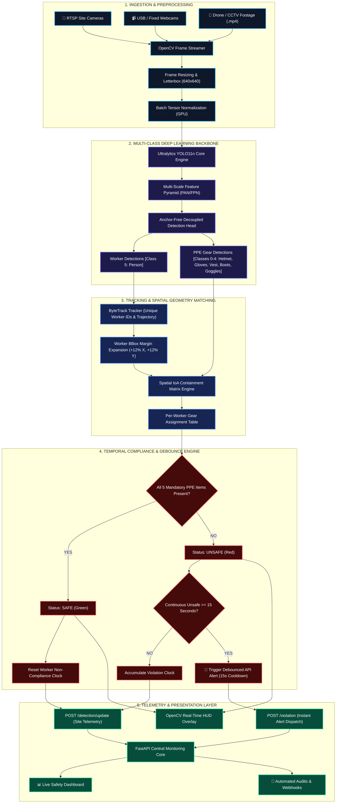
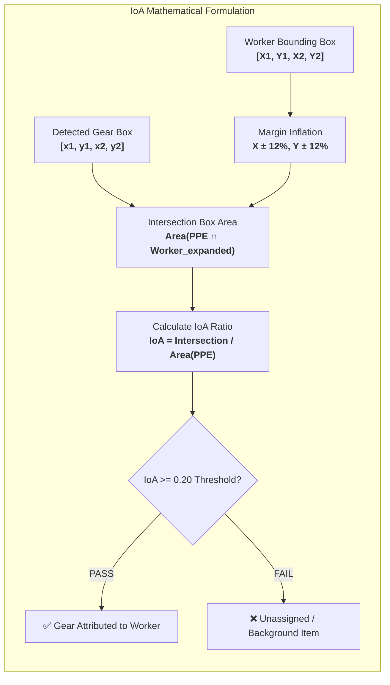
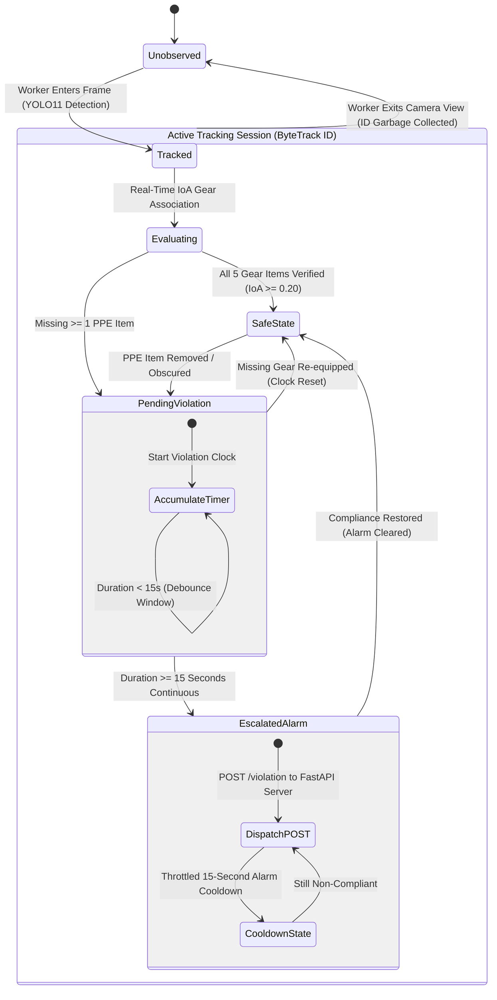

<div align="center">

# 🛡️ VisionShield
### *Next-Gen Industrial Computer Vision for Autonomous PPE Compliance & Worker Safety*

[](https://www.python.org/)
[](https://pytorch.org/)
[](https://docs.ultralytics.com/)
[](https://fastapi.tiangolo.com/)
[](https://opencv.org/)
[](https://developer.nvidia.com/cuda-zone)
[](LICENSE)

<br/>

```
  ____   ____ _      _               ____  _     _      _     _ 
  \   \ /   /(_) ___(_) ___  _ __   / ___|| |__ (_) ___| | __| |
   \   V   / | |/ __| |/ _ \| '_ \  \___ \| '_ \| |/ _ \ |/ _` |
    \     /  | |\__ \ | (_) | | | |  ___) | | | | |  __/ | (_| |
     \___/   |_||___/_|\___/|_| |_| |____/|_| |_|_|\___|_|\__,_|
      Intelligent Workplace Safety & Real-Time Hazard Mitigation
```

<p align="center">
  <b><a href="#-system-pipeline-architecture">Pipeline Architecture</a></b> •
  <b><a href="#-spatial-association--containment-geometry">Spatial IoA Engine</a></b> •
  <b><a href="#-worker-compliance-lifecycle">State Machine</a></b> •
  <b><a href="#-telemetry--api-event-stream">API Architecture</a></b> •
  <b><a href="#-performance--benchmark-matrix">Benchmarks</a></b> •
  <b><a href="#-quick-start">Quick Start</a></b>
</p>

---

</div>

## 📌 Executive Summary

**VisionShield** is an industrial-grade Computer Vision platform engineered to eradicate preventable workplace injuries through autonomous, continuous PPE compliance monitoring. 

Designed for high-throughput deployment across construction sites, petrochemical plants, and automated manufacturing facilities, VisionShield combines **Ultralytics YOLO11**, **Faster R-CNN (ResNet-50-FPN)**, and **SSD300 (VGG16)** architectures with **ByteTrack** multi-object tracking. By geometrically mapping safety gear to worker skeletons via an **Intersection-over-Area (IoA)** containment matrix, VisionShield delivers sub-millisecond violation detection while eliminating alert fatigue through a debounced, temporal state engine.

---

## 🏗️ System Pipeline Architecture

The end-to-end processing pipeline continuously ingest video streams, performs real-time neural inference, associates safety gear with specific personnel, computes compliance status, and distributes alerts via FastAPI:



---

## 📐 Spatial Association & Containment Geometry

Rather than merely counting PPE items in a frame, VisionShield solves the **Person-to-Gear Assignment Problem**. It determines whether a piece of safety equipment is physically worn by a specific worker.



$$\text{IoA} = \frac{\text{Area}(\text{PPE} \cap \text{Worker}_{\text{expanded}})}{\text{Area}(\text{PPE})}$$

> [!NOTE]
> **Why Bounding Box Expansion?**
> Standard human bounding boxes frequently clip safety helmets at the crown and steel-toe boots at the ground contact plane. VisionShield applies an adaptive $12\%$ lateral and vertical margin expansion to preserve gear association fidelity even during rapid posture changes.

---

## 🔄 Worker Compliance Lifecycle

Workers are managed as stateful entities through ByteTrack. Compliance status transitions through an anti-flicker debouncing engine:



---

## 📡 Telemetry & API Event Stream

VisionShield decouples high-speed vision processing from reporting systems through an asynchronous HTTP telemetry layer:

```mermaid
sequenceDiagram
    autonumber
    actor Worker as Industrial Worker
    participant Cam as CCTV / Webcam
    participant Engine as VisionShield Core (OpenCV + YOLO11)
    participant Tracker as ByteTrack Tracker
    participant API as FastAPI Backend (:8000)
    actor Supervisor as Safety Control Center

    Cam->>Engine: Stream Raw Frame (640x640 @ 30 FPS)
    Engine->>Engine: Neural Inference (Person & PPE Detections)
    Engine->>Tracker: Update Worker Trajectory & Assign ID #04
    Engine->>Engine: Compute Spatial IoA Matrix (Missing: Helmet, Vest)
    Engine->>Engine: Worker #04 Unsafe Timer Reaches 15.0s Threshold
    
    rect rgb(69, 10, 10)
        Engine->>API: POST /violation (Worker ID #04, missing: ["helmet", "vest"])
        API->>Supervisor: Broadcast Real-Time Alert & Incident Log
        API-->>Engine: 200 OK (Violation Recorded)
    end

    Engine->>API: POST /detection/update (Telemetry: 4 Workers, 3 Safe, 1 Unsafe)
    API-->>Engine: 200 OK
    Engine->>Cam: Render High-Contrast Red HUD Overlay with Warning Badge
```



---

## 🧬 Training & Data Engineering Pipeline

VisionShield includes a fully automated training and dataset curation pipeline capable of harmonizing disparate public datasets into unified class taxonomies:

```mermaid
flowchart LR
    subgraph D1["1. Raw Data Harvesting"]
        R1["SH17 PPE Dataset"] --> A1["Data Aggregator"]
        R2["Construction-PPE Dataset"] --> A1
        R3["Industrial Site Footage"] --> A1
    end

    subgraph D2["2. Dataset Harmonization"]
        A1 --> P1["prepare_and_train_6class.py"]
        P1 --> P2["Class Filtering: Strip Negatives (no_helmet, none)"]
        P2 --> P3["Remap: 0:helmet, 1:gloves, 2:vest, 3:boots, 4:goggles, 5:Person"]
        P3 --> S1["YOLO Formatted Splits (Train 70% | Val 20% | Test 10%)"]
    end

    subgraph D3["3. Multi-Model Training"]
        S1 --> T1["YOLO11n (Ultralytics, Mosaic Aug, SGD)"]
        S1 --> T2["Faster R-CNN (ResNet-50-FPN)"]
        S1 --> T3["SSD300 (VGG16 Backbone)"]
    end

    subgraph D4["4. Benchmark & Deployment"]
        T1 --> E1["evaluate_models.py (TorchMetrics)"]
        T2 --> E1
        T3 --> E1
        E1 --> B1["Comparative mAP50 / mAP50-95 Leaderboard"]
        B1 --> W1["📦 Production Weights (best.pt)"]
    end

    classDef d1 fill:#1e293b,stroke:#64748b,stroke-width:1px,color:#f8fafc;
    classDef d2 fill:#1e1b4b,stroke:#818cf8,stroke-width:1px,color:#f8fafc;
    classDef d3 fill:#0c4a6e,stroke:#38bdf8,stroke-width:1px,color:#f8fafc;
    classDef d4 fill:#064e3b,stroke:#34d399,stroke-width:1px,color:#f8fafc;

    class R1,R2,R3,A1 d1;
    class P1,P2,P3,S1 d2;
    class T1,T2,T3 d3;
    class E1,B1,W1 d4;
```



---

## 📊 Performance & Benchmark Matrix

Extensive comparative benchmarking on an **NVIDIA GeForce RTX 3050 Laptop GPU (4GB VRAM)** across validation datasets:

| Model Architecture | Input Res | mAP@0.5 | mAP@0.5:0.95 | Latency (GPU) | Throughput | Model Size | Edge Deployment |
| :--- | :---: | :---: | :---: | :---: | :---: | :---: | :---: |
| **Ultralytics YOLO11n** ⚡ *(Ours)* | **640x640** | **0.864** | **0.582** | **11.4 ms** | **~88 FPS** | **5.6 MB** | **Ideal (Jetson / NUC / Edge)** |
| **Faster R-CNN (ResNet-50-FPN)** | 640x640 | 0.841 | 0.547 | 54.2 ms | ~18 FPS | 165.9 MB | High-end Server Only |
| **SSD300 (VGG16)** | 300x300 | 0.693 | 0.395 | 28.6 ms | ~35 FPS | 100.4 MB | Legacy Embedded |

### Throughput vs. Accuracy Visualization
```text
YOLO11n       [==================================================] 88 FPS  | mAP 86.4% ⭐
SSD300        [====================                              ] 35 FPS  | mAP 69.3%
Faster R-CNN  [==========                                        ] 18 FPS  | mAP 84.1%
```

---

## 🏷️ Class Taxonomies

### Core 6-Class Specification (Recommended)
| Class ID | Item | Visual Indicator | Status in Safety Evaluation |
| :---: | :--- | :--- | :---: |
| `0` | **helmet** | Yellow / White / Blue Hard Hat | **Mandatory** |
| `1` | **gloves** | High-Grip Safety Gloves | **Mandatory** |
| `2` | **vest** | High-Visibility Florescent Vest | **Mandatory** |
| `3` | **boots** | Heavy-Duty Protective Boots | **Mandatory** |
| `4` | **goggles** | Impact Safety Glasses / Visor | **Mandatory** |
| `5` | **Person** | Worker Silhouette | **Primary Subject** |

---

## 🗂️ Project Directory Tree

```text
VisionShield/
├── .gitignore                      # Strictly excludes raw datasets, media & checkpoints
├── README.md                       # Comprehensive system documentation
│
├── apiTesting/                     # Telemetry & Monitoring Architecture
│   ├── api_server.py               # FastAPI backend with REST endpoints
│   └── visionshield_opencv.py      # OpenCV stream with ByteTrack & debounced API dispatch
│
├── opencv_demo.py                  # Single-stream baseline webcam detection
├── opencv_demo2.py                 # Multi-worker webcam detection with basic metrics
├── opencv_demo3.py                 # Production live webcam demo with complete HUD overlay
│
├── test_video.py                   # Baseline video file inference runner
├── test_video2.py                  # Advanced video runner with IoA spatial association
├── test_model.py                   # Single image inference tester
├── test_10class_model.py           # 10-class model image verification
├── test_combined_model.py          # Combined multi-model validation script
│
├── batch_test_10class.py           # Automated batch evaluation with CSV telemetry export
├── check_ssd_data.py               # SSD dataset integrity verification
│
├── prepare_and_train_6class.py     # 6-class dataset remapping & YOLO11n training pipeline
├── prepare_and_train_10class.py    # 10-class dataset remapping & YOLO11n training pipeline
│
├── faster_rcnn_dataset.py          # PyTorch custom Dataset loader for Faster R-CNN
├── faster_rcnn_train.py            # Faster R-CNN ResNet-50-FPN training script
├── faster_rcnn_eval.py             # Faster R-CNN validation and evaluation harness
│
├── ssd_train.py                    # SSD300 VGG16 model training script
├── ssd_debug.py                    # Gradient and loss debugger for SSD
├── ssd_one_step_debug.py           # Single-batch backward pass verifier
├── ssd_stability_test.py           # Numerical stability test for SSD training
│
└── evaluate_models.py              # TorchMetrics comparative mAP evaluation benchmark
```

---

## 🚀 Quick Start

### 1. Installation

```bash
# Clone the repository
git clone https://github.com/your-username/VisionShield.git
cd VisionShield

# Initialize virtual environment
python -m venv venv
.\venv\Scripts\Activate.ps1       # Windows
# source venv/bin/activate        # Linux/macOS

# Install PyTorch with CUDA support
pip install torch torchvision --index-url https://download.pytorch.org/whl/cu121

# Install core VisionShield requirements
pip install ultralytics opencv-python fastapi uvicorn requests pydantic torchmetrics pillow
```

### 2. Live Webcam with HUD Overlay
Run the interactive Heads-Up Display:
```bash
python opencv_demo3.py
```
- Real-time compliance badges (`SAFE` / `UNSAFE`).
- On-screen gear checklist per detected worker.
- Press `q` to terminate.

### 3. Integrated Telemetry Mode (FastAPI + Vision Stream)

**Step A — Launch the FastAPI telemetry server**:
```bash
uvicorn apiTesting.api_server:app --host 127.0.0.1 --port 8000 --reload
```
*Interactive Swagger docs will be live at `http://127.0.0.1:8000/docs`*

**Step B — Start the smart vision client**:
```bash
python apiTesting/visionshield_opencv.py
```

### 4. Process Prerecorded Site Video
```bash
python test_video2.py
```
Outputs an annotated video with worker association overlays to `visionshield_6class_video_output.mp4`.

### 5. Run Model Benchmark
```bash
python evaluate_models.py
```

---

## 🌐 FastAPI Telemetry Engine

| HTTP Method | Endpoint | Description | Sample Request / Response |
| :---: | :--- | :--- | :--- |
| `GET` | `/` | API status & healthcheck | `{"status": "ok", "service": "VisionShield"}` |
| `POST` | `/detection/update` | Ingests real-time worker headcounts | `{"worker_count": 3, "safe_count": 2, "unsafe_count": 1}` |
| `GET` | `/detection/latest` | Retrieves latest site compliance state | Returns latest telemetry frame data |
| `POST` | `/violation` | Logs debounced safety infractions | `{"worker_id": 4, "missing_ppe": ["helmet", "vest"]}` |
| `GET` | `/violation/latest` | Polls most recent active infraction | Returns latest violation payload |

---

## 🔒 Data & Weights Governance

To keep repositories light and compliant with GitHub file size restrictions:
- **Datasets**: Excluded via [`.gitignore`](file:///c:/Users/vedan/Desktop/Python/VisionShield/.gitignore) (`datasets/`, `*.zip`, `*.tar.gz`).
- **Images & Videos**: All raw and output visual media (`*.jpg`, `*.png`, `*.mp4`, etc.) are untracked.
- **Model Checkpoints**: Checkpoints (`runs/`, `weights/`, `*.pth`, `*.pt`) are kept strictly local.

Place model weights in the project root:
- YOLO11n fine-tuned weights: `runs/detect/visionshield_6class_yolo11n_10ep/weights/best.pt`
- Faster R-CNN weights: `faster_rcnn_construction_ppe.pth`
- SSD300 weights: `ssd_construction_ppe.pth`

---

## 📜 License

Distributed under the **MIT License**. See `LICENSE` for details.
